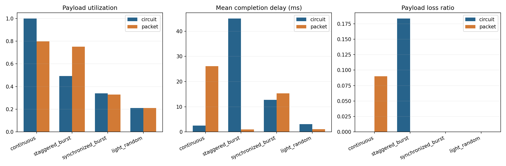
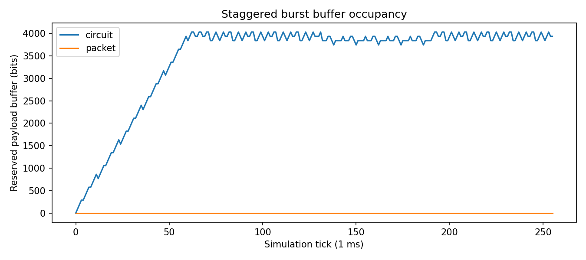
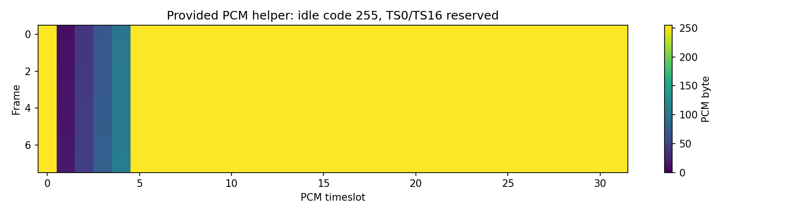

# 实验一报告

姓名：刘梓皓  学号：2024280422  GitHub：Kozeki0423  提交编号：34

## 实验目的

比较固定时隙电路交换与共享 FIFO 分组交换在相同业务输入、链路容量、缓存容量和观察窗口下的资源利用率、完成时延、丢失与积压。实验需要说明：固定预留何时浪费容量，统计复用何时获益；包头开销和集中突发又会如何抵消统计复用的收益。实验不预设某一种交换方式总是更优。

## 原理和模型

**固定时隙电路交换**在连接建立后为每名用户周期性地预留发送机会，本实验中由 `tick % users` 决定当前时隙归属。用户无数据时，该时隙仍然空闲，其他用户不能借用。4 用户、每 tick 128 bit、1 ms/tick 时，总速率 128 kbit/s，每用户长期保证 32 kbit/s。

**分组交换**把所有用户的数据记录放入共享 FIFO，任何用户都可以使用空闲的链路容量，这就是统计复用。每条记录到达时附加一次 32 bit 包头；记录可以跨 tick 续传，未发完时保留 `remaining_wire_bits`，不允许其他记录插队，也不允许重新加头。

**缓存准入**：两模型都按未完成记录的原始 payload 预留 4096 bit 空间，包含正在传输的记录；新记录放不下时整条尾丢弃。包头只增加线路开销，不增加 payload 缓存配额。这是课堂模型，不是真实设备存储器的精确建模。

**观察窗口**只取 `[0, 256)` tick，不追加排空时间。tick 结束时完整送达才算完成，时延 = 完成边界 − 生成时刻。窗口结束时未完成的记录计为积压，不算丢包。因此有限窗口指标是特定条件下的结果，不是无限长稳态的理论结论。

**与 PCM 示例的区别**：`pcm_frame_view.png` 使用 32 时隙 × 8 bit × 8000 帧/s，对应 2.048 Mbit/s；本实验比较链路是 128 kbit/s 的抽象配置，两者速率与用途不同，不能混为一谈，PCM 工具只用于展示时隙和帧结构。

## 手工推演

取 `users=2, ticks=2, slot_bits=128, header_bits=32`，到达为：tick 0 用户 0 生成 96 bit，tick 1 用户 0 再生成 96 bit。

**电路交换**

| tick | 当前时隙用户 | 发送 | 完成 | 积压 |
|---|---|---|---|---|
| 0 | 0 | 用户0 第1条 96 bit | 第1条，时延 1 tick | 用户0 队列空 |
| 1 | 1 | 用户1 队列为空，不借用该时隙 | 无 | 用户0 第2条 96 bit 等待 |

窗口在 tick 2 前结束，第 2 条未发送。手算：generated = 192，delivered = 96，backlog = 96，wire = 96，loss = 0；有效载荷利用率 = 96/(2×128) = 0.375，平均时延 = 1 ms。

**分组交换**

| tick | 队首记录（wire bit） | 发送 | 完成 |
|---|---|---|---|
| 0 | 用户0 第1条 96+32=128 | 128，发完 | 时延 1 tick |
| 1 | 用户0 第2条 96+32=128 | 128，发完 | 时延 1 tick |

手算：generated = 192，delivered = 192，backlog = 0，wire = 256，loss = 0；有效载荷利用率 = 192/256 = 0.75，平均时延 = 1 ms。

先写出上述预期后再运行代码，`student_tests/test_my_case.py::test_two_user_two_tick_handwork` 的断言与运行结果一致。该例说明：同一用户连续到达时，电路的空闲预留时隙不能借用，而分组共享队列可以立即使用链路。

## 实验结果

四种业务、两种方式的完整结果如下（`results/comparison.csv`，seed = 2026）：

| 业务 | 方式 | 有效载荷利用率 | 线路忙碌率 | 平均时延/ms | 最大时延/ms | 丢失率 | 积压/bit |
|---|---|---:|---:|---:|---:|---:|---:|
| continuous | circuit | 1.000 | 1.000 | 2.50 | 4.0 | 0 | 0 |
| continuous | packet | 0.797 | 1.000 | 26.15 | 40.0 | 0.0898 | 3712 |
| staggered_burst | circuit | 0.492 | 0.495 | 45.10 | 127.0 | 0.1836 | 3936 |
| staggered_burst | packet | 0.750 | 1.000 | 1.00 | 1.0 | 0 | 0 |
| synchronized_burst | circuit | 0.340 | 0.344 | 12.71 | 24.0 | 0 | 1152 |
| synchronized_burst | packet | 0.328 | 0.438 | 15.36 | 32.0 | 0 | 1536 |
| light_random | circuit | 0.211 | 0.211 | 3.11 | 10.0 | 0 | 0 |
| light_random | packet | 0.211 | 0.281 | 1.10 | 2.0 | 0 | 0 |

**利用率和时延指向不同结论的例子**：`synchronized_burst` 中，分组交换的线路忙碌率 0.438 高于电路交换的 0.344，但有效载荷利用率 0.328 反而低于电路的 0.340，平均完成时延 15.36 ms 也高于电路的 12.71 ms。原因是分组方式把线路时间花在了包头和排队上，同时窗口结束时仍积压 1536 bit；线路更忙并不等于有效吞吐更高或时延更低。

**其他观察**：

- `continuous` 满载连续业务：电路交换每个时隙都被对应记录填满，利用率 1.0、无丢失、无积压；分组交换因 128 bit 记录加 32 bit 头需要 160 bit，跨两个时隙，产生 9.0% 尾丢弃和 3712 bit 积压，利用率降到 0.797。说明固定预留与均匀流量匹配时分组未必更好。
- `staggered_burst` 错峰突发：每 tick 只有一个用户活跃，电路的固定时隙大部分空转，利用率仅 0.492，并有 18.4% 丢失和大量积压；分组共享队列可立即使用全部链路，利用率 0.750、时延 1 ms、无丢失。这是统计复用获益最明显的场景。
- `light_random` 轻载随机：两方式有效载荷利用率相同（0.211），说明轻载下利用率由业务总量而非分配方式决定；分组因共享队列不再等固定时隙，平均时延 1.10 ms 低于电路的 3.11 ms，同时线路忙碌率略高（0.281 对 0.211），体现了包头开销。

**选做参数扫描**（`results/extra/header_buffer_sweep.csv`）：

- 包头长度 0/16/32/64 bit：`continuous` 分组有效利用率依次为 1.000、0.887、0.797、0.664，丢失率 0、0、9.0%、21.9%；包头越大，满载连续业务中分组越不利。`staggered_burst` 分组在 0/16/32 bit 时保持 0.750，64 bit 时降到 0.598 并出现 3.9% 丢失。
- 缓存 1024/4096/16384 bit：`synchronized_burst` 分组在 1024 bit 时丢失率高达 68.75%（突发放不下），4096 和 16384 bit 时丢失率为 0、积压 1536 bit。说明集中突发下的结论强烈依赖缓存是否足以吸收突发：缓存过小会把排队直接转化为尾丢弃，但缓存一旦足够，继续增大也不会改变本窗口内的结果。

## 自拟反例

`student_tests/test_my_case.py` 包含 5 个测试：

1. `test_two_user_two_tick_handwork`：2 用户 2 tick，两条记录都来自用户 0，手算并断言电路 delivered=96、backlog=96、wire=96，分组 delivered=192、wire=256、两条时延均为 1。可揭示两类错误：电路借用其他用户的空闲时隙，或分组未按共享 FIFO 发送。
2. `test_circuit_idle_slot_not_borrowed`：tick 0 属于用户 0，用户 1 的 32 bit 必须原样保留；若实现错误地让其他用户借用时隙，该断言会失败。
3. `test_packet_large_record_resumes_without_second_header`：232 bit wire 记录拆成 128 + 104，要求在下一个 tick 续传且不再加 32 bit 头；若实现每次续传重新加头或丢弃大分组，会暴露错误。
4. `test_window_end_backlog_is_not_loss`：1 tick 窗口内 200 bit 只发出 128 bit，断言 loss=0、backlog=200、平均/最大时延为 `None`；可揭示把未完成数据误记为丢包、或无样本时把时延写成 0 的错误。
5. `test_metrics_conservation_violation_raises`：构造 generated=100 但 40+20+30=90 的数据，断言 `summarize` 抛出 `ValueError`；可揭示守恒检查缺失。

运行结果：`python -m pytest student_tests -q` 为 5 passed。

## 分析与限制

- **统计复用何时有优势**：业务在时间上错峰、用户热点轮换或整体轻载时，共享队列可以使用其他用户空闲的容量，如 `staggered_burst` 和 `light_random` 的时延改善。
- **满载连续场景为什么分组未必更好**：所有时隙本来都能被利用，固定预留没有浪费；分组反而为每条记录付出 32 bit 包头，128 bit 载荷加头后超过一个时隙，导致排队、积压和尾丢弃。
- **未完成数据能不能算丢包**：不能。它们仍在缓存中等待发送，属于积压；实验中只有准入失败被整条丢弃的记录才计入丢失。把积压当丢失会高估分组方式的损失，也会破坏守恒关系。
- **为什么不能只看成功记录的平均时延**：平均时延只统计已完成的记录。如果实现或业务只让少量数据及时完成、大量数据在积压或已被丢弃，平均时延可能很好看。例如 `continuous` 分组平均时延 26.15 ms，同时丢失 9.0%、积压 3712 bit；必须把时延、丢失率和积压一起解释。
- **模型限制**：只考虑预先建立的单链路承载，忽略建链、传播、误码、重传、路由与多跳；缓存计量是教学简化；观察窗口只有 256 tick，结果依赖固定 seed 与当前参数。参数扫描表明包头从 0 增至 64 bit、缓存从 4096 减至 1024 bit 都会改变结论，因此不能把这些曲线外推为真实互联网或电信系统的普遍结论。

## AI使用说明

本实验使用了 AI 编程助手辅助实现三个 TODO、编写自拟测试和整理报告。完整过程见 [AI_LOG.md](AI_LOG.md)。核心验证方式是先手算 2 用户 2 tick 的预期，再运行测试核对；其中自拟测试第一版的到达序列选得不够有区分度，经手算核对后改为同一用户连续到达，才真正暴露固定时隙不能借用的问题。核心循环方面，`serve_packet` 与 `serve_circuit` 都采用“在 tick 预算内循环扣减队首记录的 `remaining_wire_bits`，发完才 `popleft` 并计入完成”，续传时只使用框架已初始化好的剩余线速比特，因此不会重加包头；`summarize` 的守恒检查确保积压被单独统计而不是混入丢包。

## 参考资料

1. 本仓库 `README.md`、`docs/model_contract.md`、`docs/theory_circuit.md`、`docs/theory_packet.md`。
2. `materials/teacher_lab_guide.md`、`materials/lecture_slides_outline.md`。
3. 教师提供的 `examples/teacher_results/comparison.csv`（仅用于核对结果量级，未复制为本人结果）。
4. 运行结果：`results/comparison.json`、`results/comparison.csv`、`results/extra/header_buffer_sweep.csv`。

## 常见问题

- **大分组超过一个tick怎么办？** 保留remaining_wire_bits，下一个tick继续发送，不重新加头。
- **为什么时延低却未必更好？** 可能只送达少量数据，其他仍在积压或已丢失。
- **结果与示例不一致？** 先检查固定种子、服务顺序、包头和统计窗口，再用小例子定位。
- **TODO失败能否提交？** 可以分阶段提交，查看反馈后改进，最终按提交截止版本评分。
